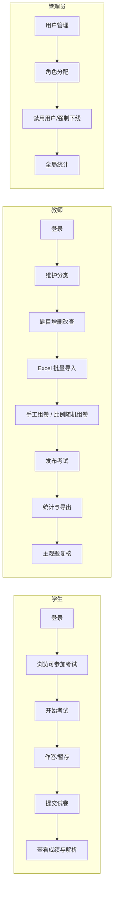
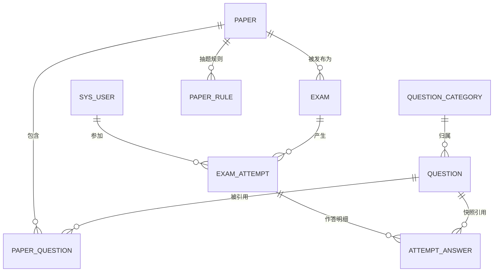
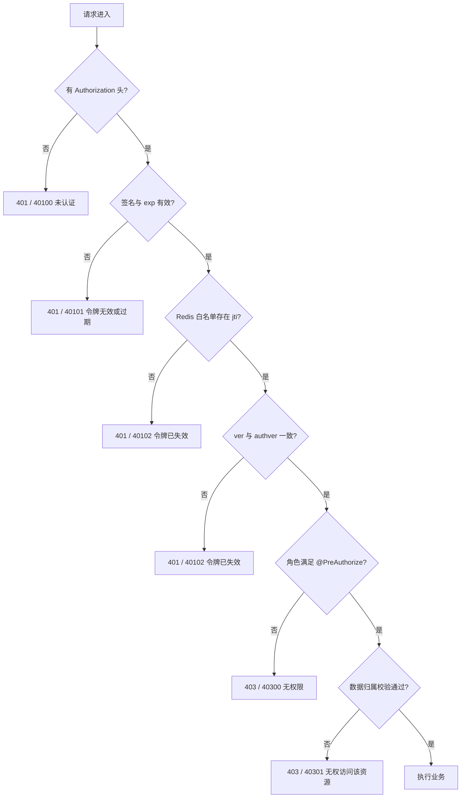
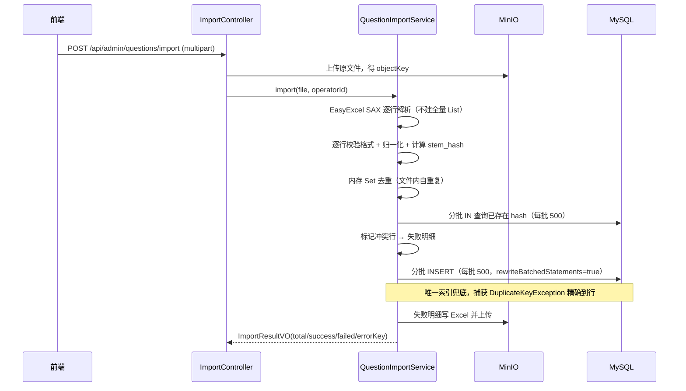
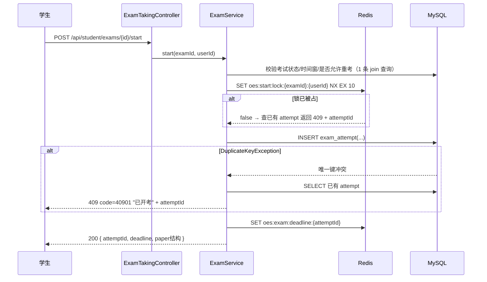

# 在线考试系统 —— 需求分析与方案设计

| 项 | 内容 |
|---|---|
| 项目名称 | 在线考试系统（Online Exam System，下称 OES） |
| 文档版本 | V1.0 |
| 编写日期 | 2026-11-26 |
| 覆盖阶段 | 需求分析（阶段一）、方案设计（阶段二） |
| 后续文档 | 02-过程记录册、03-接口文档（Knife4j 在线）、04-测试报告、05-部署手册 |

---

## 一、需求分析

### 1.1 项目背景与目标

面向学校/培训机构的小型在线考试场景，提供"建题库 → 组卷 → 组织考试 → 作答 → 自动判卷 → 成绩统计"的闭环。

系统的核心难点不在功能数量，而在于**6 个可量化指标**，它们决定了架构与技术方案：

| 编号 | 指标 | 本质挑战 | 对应设计章节 |
|---|---|---|---|
| M1 | 导入 1000 条 ≤30 秒；重复题干拦截 | 批量写性能 + 文本级去重 | 2.7.3 |
| M2 | 抽题不重复；总分与设定偏差为 0 | 随机算法 + 分值整数化 + 不变量校验 | 2.7.4 |
| M3 | 同一考生不可重复开考；提交事务完整 | 分布式并发下的唯一性 + 原子性 | 2.7.5 / 2.7.6 |
| M4 | 边界分数判定正确，无浮点误差 | 金额级精度处理 | 2.7.8 |
| M5 | 1000 条数据响应 ≤1 秒；SQL 条数常数级 | 消除 N+1，覆盖索引 | 2.7.9 |
| M6 | 越权访问返回 403；令牌可失效 | 认证与鉴权解耦、主动失效 | 2.7.1 / 2.7.2 |

> 设计原则：**所有指标必须可在测试报告中用一条命令复现**，不接受"体感很快""基本不会重复"这类结论。因此每个指标在下文都给出"可测量的定义 + 判定方法"。

### 1.2 角色与权限边界

| 角色 | 说明 | 主要权限 |
|---|---|---|
| 学生 STUDENT | 参加考试 | 查看可参加的考试、开考、作答、交卷、查本人成绩与答卷解析 |
| 教师 TEACHER | 内容与考试运营 | 题库分类/题目维护、批量导入、组卷、发布考试、查看本人所建考试的统计与导出、人工复核主观题 |
| 管理员 ADMIN | 系统运营 | 用户管理、角色分配、全部考试统计、系统参数、查看操作日志 |

权限模型采用 **RBAC + 数据归属（Data Scope）** 双层校验：

- 功能级：`role → permission` 判断"能不能调这个接口"；
- 数据级：判断"这条数据是不是你的"（教师只能操作 `created_by = 自己` 的试卷/考试）。

两层任一不通过均返回 **403**，不返回 404 掩盖（避免前端无法区分"不存在"和"无权限"带来的调试成本，且符合指标要求）。

### 1.3 用例总览



### 1.4 功能需求

编号规则：`FR-模块-序号`。每条需求均给出**验收标准**，作为后续测试用例的来源。

#### FR-01 题目管理

| 编号 | 需求 | 验收标准 |
|---|---|---|
| FR-01-01 | 分类树维护（增删改查、排序、启用/停用） | 分类最多 3 级；含子分类或有题目的分类不可删除，返回明确业务提示 |
| FR-01-02 | 题目新增/编辑/删除/详情 | 题型支持单选、多选、判断、填空、简答；选项 ≥2；正确答案必填且必须落在选项内 |
| FR-01-03 | 题目分页查询 | 支持按分类、题型、难度、关键字（题干模糊）、状态组合筛选；分页参数非法返回 400 |
| FR-01-04 | 批量导入（Excel） | 1000 条 ≤30 秒；逐行校验，失败行不落库并生成"失败明细"文件；返回 成功数/失败数/失败原因分布 |
| FR-01-05 | 重复题干拦截 | 同一题干（归一化后）在库中已存在时，该行必须被拒绝，且不得产生半条数据 |
| FR-01-06 | 题干去重口径可解释 | 归一化规则：去首尾与中间空白、全角转半角、中英文标点统一、英文转小写 |

**业务规则**

- R1：题目一旦被任一试卷引用，**不允许物理删除**，只能"停用"。（原因：历史答卷需要还原题干，删除会导致成绩无法追溯。）
- R2：停用的题目不参与组卷抽题，但历史试卷中的引用保持不变（组卷时已做快照，见 2.7.4）。
- R3：题干归一化后的 SHA-256 作为唯一键，数据库层加唯一索引兜底，应用层做批量预检（两道防线，见 2.7.3）。

#### FR-02 试卷管理

| 编号 | 需求 | 验收标准 |
|---|---|---|
| FR-02-01 | 手工组卷 | 从题库勾选题目加入试卷，可调顺序、可单独设分值；同题不可重复加入（前端置灰 + 后端唯一索引） |
| FR-02-02 | 按比例随机抽题 | 按"题型 + 每题分值 + 数量"定义抽题规则，一键抽题；支持限定分类范围与难度分布 |
| FR-02-03 | 总分校验 | 规则保存时校验 `Σ(数量×分值) == 设定总分`，不等则拒绝并返回差额；发布前再次校验实际题目汇总值 |
| FR-02-04 | 抽题不重复 | 同一试卷内 `question_id` 唯一（应用层 Set + DB 唯一索引 `uk_paper_question`） |
| FR-02-05 | 试卷预览/编辑/删除/发布 | 已发布（被考试引用）的试卷不可改结构，只能复制为新版本 |

**业务规则**

- R4：总分偏差为 0 的实现方式是**约束前置**，而非事后调分。任何会导致偏差的操作在保存阶段即被拒绝，因此系统内不存在"差 1 分"的中间状态。
- R5：组卷时若某题池可用题数 < 需求数量，整卷失败并提示缺口（不做"能抽多少抽多少"的降级，否则必然产生总分偏差）。

#### FR-03 考试与作答

| 编号 | 需求 | 验收标准 |
|---|---|---|
| FR-03-01 | 创建/发布考试 | 绑定试卷、设定开考与结束时间窗、时长、及格线、是否允许重考、是否乱序 |
| FR-03-02 | 学生开始考试 | 校验时间窗、状态、是否已考；成功则生成答卷（attempt）并返回服务端截止时间 |
| FR-03-03 | 同一考生不可重复开考 | 同一 `exam_id + user_id` 仅一条答卷；重复开考返回 409 并回带已有 `attemptId`，前端直接续考 |
| FR-03-04 | 作答暂存 | 每 10 秒或切题时批量上报，服务端幂等写入，不因网络重试产生重复行 |
| FR-03-05 | 限时提交 | 以服务端时间为准；提交后立即返回判分结果（客观题）与"主观题待复核"状态 |
| FR-03-06 | 超时处理 | 到达截止时间未提交者，由定时任务自动交卷；超时后手动提交仍受理但标记 `TIMEOUT`，且不得修改已存答案 |
| FR-03-07 | 交卷幂等 | 重复提交返回同一份结果，不重复判分、不重复累加分数 |

**业务规则**

- R6：倒计时**只用于前端展示**，服务端保存 `deadline`，一切判定以服务端 `LocalDateTime.now()` 为准（防改本地时间作弊）。
- R7：乱序只影响展示顺序（`sort_no` 随机化后存快照），不影响判分。

#### FR-04 自动判卷

| 编号 | 需求 | 验收标准 |
|---|---|---|
| FR-04-01 | 客观题自动判分 | 单选/判断全等得分；多选按"全对满分、少选按比例、错选零分"规则 |
| FR-04-02 | 填空题判分 | 归一化后比对；多空题按空计分，支持"或"关系答案（`A|a`） |
| FR-04-03 | 主观题规则评分 | 关键词命中计分 + 最小字数门槛；得分不超过满分；结果标记 `NEED_REVIEW=true` 供教师复核 |
| FR-04-04 | 边界分数正确 | 0 分、满分、半分、多选少选、空答案、全错答案等边界用例全部通过；任意组合下 `0 ≤ score ≤ fullScore` |
| FR-04-05 | 无浮点误差 | 分值以整数（0.01 分）存储与运算，全程无 `float/double`；`0.1+0.2` 类断言必须精确等于 `0.30` |

#### FR-05 记录统计

| 编号 | 需求 | 验收标准 |
|---|---|---|
| FR-05-01 | 按考试聚合 | 列表展示：参考人数、提交人数、平均分、最高/最低分、及格率 |
| FR-05-02 | 分页查询 | 支持按考试、时间范围、班级/用户、及格状态筛选；1000 条数据 P95 ≤1s |
| FR-05-03 | SQL 条数为常数级 | 单次请求 SQL 条数不随数据量增长（固定 3 条），日志可证 |
| FR-05-04 | 导出 | 导出成绩明细 Excel；≤5000 行同步流式导出，>5000 行转异步任务并通知下载 |
| FR-05-05 | 答卷详情 | 查看单份答卷的每题得分、正确答案、解析（学生端在教师设置允许后可见） |

#### FR-06 用户与权限

| 编号 | 需求 | 验收标准 |
|---|---|---|
| FR-06-01 | 登录 | 用户名 + 密码；密码 BCrypt 存储；连续 5 次失败锁定 10 分钟 |
| FR-06-02 | 令牌签发 | 登录返回 accessToken（2h）；响应体不落 localStorage 明文风险由前端策略控制 |
| FR-06-03 | 角色区分 | 接口按 `@PreAuthorize("hasRole('TEACHER')")` 等注解校验 |
| FR-06-04 | 越权访问返回 403 | 学生调用教师接口 → 403；教师访问他人考试数据 → 403；均返回统一错误码 |
| FR-06-05 | 令牌可失效 | 登出、改密、被禁用、被管理员强制下线后，旧令牌立即不可用（≤1 次请求内生效） |
| FR-06-06 | 用户管理 | 管理员可增删改查用户、重置密码、启停账号、改角色 |

### 1.5 关键指标的"可测量定义"

这一节把题目给的指标翻译成测试可执行的判据，避免验收时扯皮。

| 指标 | 可测量定义 | 测量方法 |
|---|---|---|
| 导入 1000 条 ≤30s | 从 HTTP 请求进入到响应返回的**服务端耗时**（不含前端上传） | JMeter 单请求计时 + 应用内 `StopWatch` 分段埋点 |
| 重复题干拦截 | 导入文件含 N 条重复（库内已存在 K 条 + 文件内自重复 J 条），响应 `success = 总数 - K - J`，且库中 `COUNT(*)` 增量等于 `success` | 导入前后各 `COUNT(*)`，比对期望值 |
| 抽题不重复 | 生成 100 份试卷，每份 `COUNT(DISTINCT question_id) == COUNT(*)` | SQL 断言 + 单元测试 Property Test |
| 总分偏差 0 | `SUM(score) - paper.total_score == 0`，且 `COUNT(*) == paper.total_count` | 发布前校验 + 测试断言 |
| 不可重复开考 | 50 并发同一考生开考，成功数 = 1，其余 409 | JMeter 并发组 + DB 唯一索引计数 |
| 提交事务完整 | 注入故障（判分抛异常）后，答卷状态仍为 `IN_PROGRESS`，无孤儿明细 | 单元测试 mock 异常 |
| 边界分正确 | 表驱动测试，覆盖 24 个边界用例（见 2.11） | JUnit5 `@ParameterizedTest` |
| 无浮点误差 | 断言使用 `assertEquals(30, scoreCent)`（整数） | 静态检查禁止 `double/float` 出现于 `score` 相关字段（ArchUnit 规则） |
| 1000 条 ≤1s | 预热后连续 20 次请求，取 P95 | JMeter + `SHOW PROFILES` |
| SQL 常数级 | 开 MyBatis 拦截器统计单请求 SQL 数，恒为 3 | 日志断言 / p6spy |
| 越权 403 | 学生 token 调 `POST /api/admin/questions` → HTTP 403 + `code=40300` | 接口测试 |
| 令牌可失效 | 登出后立即用旧 token 请求 → 401 `code=40102` | 接口测试 |

### 1.6 非功能需求

| 类别 | 要求 |
|---|---|
| 性能 | 单机 4C8G；常规接口 P95 ≤300ms；统计接口 1000 条 ≤1s；支持 200 人同时在线作答 |
| 可用性 | 考试期间核心链路（开考/暂存/提交）可用性优先，非核心（统计、导出）可降级 |
| 安全 | 密码 BCrypt(cost=10)；JWT HS256；接口全量鉴权；SQL 全部参数化；上传文件类型/大小白名单；敏感操作留痕 |
| 数据一致性 | 交卷、判分、成绩写入在**同一事务**；关键唯一性由数据库约束保证，不依赖应用层判断 |
| 可维护性 | 分层清晰，controller/service/mapper 职责单一；核心逻辑单测覆盖率 ≥70% |
| 可移植性 | `docker compose up` 一键起 MySQL/Redis/MinIO/后端/前端 |
| 可观测 | 统一 traceId 贯穿日志；慢 SQL（>200ms）打印 |

### 1.7 约束与假设

- 单体应用（模块化分包），不引入微服务：本场景数据量与团队规模不支持分布式复杂度。
- 不支持断网续考之外的离线作答；考试期间弱网以"本地暂存 + 幂等上报"兜底。
- 主观题自动评分为**辅助**，最终以教师复核为准（规则评分只解决"及格线附近的粗筛"）。
- 单个 Excel 导入上限 5000 行；导出上限 5000 行同步、超出走异步。

---

## 二、方案设计

### 2.1 总体架构

前后端分离，后端单体分层，基础设施全部容器化。

```
┌──────────────────────────────────────────────────────────────┐
│  浏览器  Vue3 + Element Plus + Vite + Pinia + Axios           │
└───────────────┬──────────────────────────────────────────────┘
                │ HTTPS / JSON  (JWT in Authorization)
┌───────────────▼──────────────────────────────────────────────┐
│  Nginx  静态资源 + /api 反向代理 + gzip + 限流                 │
└───────────────┬──────────────────────────────────────────────┘
┌───────────────▼──────────────────────────────────────────────┐
│  Spring Boot 3.2 / Java 17                                    │
│  ┌────────────────────────────────────────────────────────┐  │
│  │ web        controller（参数校验 + 组装响应）             │  │
│  │ security   JWT 过滤器 / 权限注解 / 数据域校验            │  │
│  │ service    业务编排、事务边界、领域规则                   │  │
│  │ mapper     MyBatis-Plus + 手写 XML（复杂聚合）           │  │
│  │ infra      Redis / MinIO / Excel / 定时任务              │  │
│  └────────────────────────────────────────────────────────┘  │
└──┬────────────────┬──────────────────┬───────────────────────┘
   │                │                  │
┌──▼──────┐  ┌──────▼──────┐  ┌────────▼────────┐
│ MySQL 8 │  │  Redis 7    │  │  MinIO          │
│ 业务数据 │  │ 会话/缓存/锁 │  │ 导入导出文件     │
└─────────┘  └─────────────┘  └─────────────────┘
```

**为什么是单体而不是微服务**：6 个模块共享同一事务边界（交卷要同时写答卷、明细、成绩），拆分会引入分布式事务；数据规模在百万级以内，单体 + 良好分层完全够用。分层清晰比部署形态更重要。

### 2.2 技术选型

| 层次 | 选型 | 版本 | 选择理由 / 关键配置 |
|---|---|---|---|
| 语言 | Java | 17 (LTS) | 题目要求；record / sealed / text block 提升 DTO 表达力 |
| 框架 | Spring Boot | 3.2.x | 题目要求；原生支持 Jakarta、虚拟线程（可选开启） |
| ORM | MyBatis-Plus | 3.5.7+ | 题目要求；`mybatis-plus-spring-boot3-starter` 才适配 Boot 3 |
| 数据库 | MySQL | 8.0.36 | 题目要求；需要 `utf8mb4_0900_ai_ci`、函数索引、窗口函数 |
| 缓存 | Redis | 7.2 | 题目要求；令牌白名单、考试截止时间、防重复开考、热点题目缓存 |
| 对象存储 | MinIO | RELEASE.2024 | 题目要求；导入原文件留档 + 失败明细 + 导出文件。**运行时以 RustFS 替代**（MinIO 官方已归档停发），Java 侧仍用 MinIO SDK，取舍见 2.6 与 `02-开发日志` D-002 |
| 接口文档 | Knife4j | 4.5.0 | `knife4j-openapi3-jakarta-spring-boot-starter`，与 springdoc 2.x 对应 |
| Excel | EasyExcel (FastExcel) | 4.x | SAX 流式读写，1000 行内存占用 <10MB；不用 POI 的 `XSSFWorkbook` 全量加载 |
| 认证 | jjwt | 0.12.x | 轻量；HS256；自定义 `jti` + `ver` 声明 |
| 密码 | Spring Security Crypto | 6.x | BCrypt，仅用其 `PasswordEncoder`，不引入完整 Spring Security 过滤器链（降低学习/调试成本） |
| 参数校验 | Jakarta Validation | 3.x | `@Valid` + 自定义 `@ExamTime` 等约束 |
| 映射 | MapStruct | 1.5.x | 编译期生成 Entity/DTO/VO 转换，避免手写 setter 与反射开销 |
| 定时任务 | Spring `@Scheduled` + ShedLock | 6.x / 5.x | 单机即可；ShedLock 防止多实例重复执行（为将来扩容留口） |
| 测试 | JUnit5 + Mockito + Testcontainers | - | 集成测试用真实 MySQL/Redis 容器，避免 H2 方言差异掩盖问题 |
| 前端 | Vue 3.4 + Element Plus 2.7 + Vite 5 | - | 题目要求；`<script setup>` + TypeScript |
| 状态/路由 | Pinia + Vue Router 4 | - | 路由守卫做角色级页面拦截（仅体验层，安全仍由后端保证） |
| 构建 | Maven 3.9 / pnpm | - | 后端多模块（`oes-common` / `oes-admin` / `oes-web`）可选，先单模块分包 |

### 2.3 代码分层与包结构

```
com.example.oes
├── common
│   ├── result        R<T>, PageResult<T>, ResultCode
│   ├── exception     BizException, GlobalExceptionHandler
│   ├── constant      RedisKey, ExamStatus, QuestionType
│   └── util          StemNormalizer, ScoreUtil, ExcelUtil
├── config            MybatisPlusConfig, RedisConfig, MinioConfig, Knife4jConfig
├── security          JwtService, AuthInterceptor, RoleAspect, LoginUser, UserContext
├── controller
│   ├── admin         QuestionController, PaperController, ExamController, StatController, UserController
│   └── student       ExamTakingController, MyScoreController
├── service
│   ├── QuestionService / impl
│   ├── PaperService / impl
│   ├── ExamService / impl
│   ├── AnswerService / impl
│   ├── JudgeService / impl
│   ├── StatService / impl
│   └── AuthService / impl
├── mapper            *Mapper（继承 BaseMapper + 少量 XML）
├── entity            DO（与表一一对应）
├── dto               入参（含校验注解）
├── vo                出参（永不复用 entity，防止密码等字段泄漏）
└── converter         MapStruct 接口
```

**分层纪律（用 ArchUnit 强制，而非口头约定）**

1. `controller` 只允许：`@Valid` 校验、取 `LoginUser`、调一个 service 方法、返回 `R`。**禁止出现 if/else 业务分支、禁止直接注入 Mapper、禁止 `@Transactional`**。
2. `service` 是唯一允许出现 `@Transactional` 的层；跨表写操作必须在一个 service 方法内完成。
3. `mapper` 只做数据访问：**禁止在 XML 里写业务判断**（如 `if status==1 then ...`），复杂聚合允许写 SQL，但"该不该聚合"由 service 决定。
4. `entity` 禁止出现在 controller 出入参中。
5. `score` 相关字段禁止 `double/float`（ArchUnit 规则拦截）。

### 2.4 数据库设计

#### 2.4.1 ER 关系



#### 2.4.2 表清单

| 表 | 作用 | 预估量级 |
|---|---|---|
| `sys_user` | 用户与角色 | 万级 |
| `question_category` | 题目分类树 | 百级 |
| `question` | 题目主表 | 十万级 |
| `paper` | 试卷 | 千级 |
| `paper_rule` | 抽题规则（题型/数量/分值/范围） | 万级 |
| `paper_question` | 试卷题目（含分值快照） | 十万级 |
| `exam` | 考试场次 | 千级 |
| `exam_attempt` | 答卷（一次考试一份） | 百万级 |
| `attempt_answer` | 作答明细 | 千万级 |
| `import_task` | 导入任务与失败明细文件 | 千级 |
| `export_task` | 异步导出任务 | 千级 |
| `operation_log` | 敏感操作留痕 | 百万级 |

#### 2.4.3 核心 DDL

```sql
-- ---------- 用户 ----------
CREATE TABLE sys_user (
  id            BIGINT       NOT NULL AUTO_INCREMENT,
  username      VARCHAR(50)  NOT NULL COMMENT '登录名',
  password      VARCHAR(100) NOT NULL COMMENT 'BCrypt',
  real_name     VARCHAR(50)  NOT NULL,
  role_code     VARCHAR(20)  NOT NULL COMMENT 'ADMIN/TEACHER/STUDENT',
  status        TINYINT      NOT NULL DEFAULT 1 COMMENT '1启用 0禁用',
  auth_version  INT          NOT NULL DEFAULT 0 COMMENT '权限版本，改密/改角色+1，用于令牌失效',
  last_login_at DATETIME     NULL,
  created_at    DATETIME     NOT NULL DEFAULT CURRENT_TIMESTAMP,
  updated_at    DATETIME     NOT NULL DEFAULT CURRENT_TIMESTAMP ON UPDATE CURRENT_TIMESTAMP,
  PRIMARY KEY (id),
  UNIQUE KEY uk_username (username),
  KEY idx_role_status (role_code, status)
) ENGINE=InnoDB DEFAULT CHARSET=utf8mb4 COLLATE=utf8mb4_0900_ai_ci;

-- ---------- 题目 ----------
CREATE TABLE question (
  id            BIGINT       NOT NULL AUTO_INCREMENT,
  category_id   BIGINT       NOT NULL,
  type          VARCHAR(16)  NOT NULL COMMENT 'SINGLE/MULTIPLE/JUDGE/BLANK/SHORT',
  stem          TEXT         NOT NULL COMMENT '题干原文',
  stem_hash     CHAR(64)     NOT NULL COMMENT '归一化题干 SHA-256，重复拦截依据',
  options_json  JSON         NULL COMMENT '[{"key":"A","content":"..."}]',
  answer_json   JSON         NOT NULL COMMENT '["A"] / ["A","C"] / ["正确"] / ["答案1","答案2"]',
  analysis      TEXT         NULL,
  difficulty    TINYINT      NOT NULL DEFAULT 2 COMMENT '1易 2中 3难',
  default_score INT          NOT NULL COMMENT '默认分值，单位 0.01 分',
  status        TINYINT      NOT NULL DEFAULT 1 COMMENT '1启用 0停用（停用替代删除）',
  created_by    BIGINT       NOT NULL,
  created_at    DATETIME     NOT NULL DEFAULT CURRENT_TIMESTAMP,
  updated_at    DATETIME     NOT NULL DEFAULT CURRENT_TIMESTAMP ON UPDATE CURRENT_TIMESTAMP,
  PRIMARY KEY (id),
  UNIQUE KEY uk_stem_hash (stem_hash),          -- M1：重复题干最终防线
  KEY idx_cat_type_status (category_id, type, status, id),  -- 抽题覆盖索引
  KEY idx_type_diff (type, difficulty, status, id)
) ENGINE=InnoDB DEFAULT CHARSET=utf8mb4 COLLATE=utf8mb4_0900_ai_ci;

-- ---------- 试卷 ----------
CREATE TABLE paper (
  id           BIGINT      NOT NULL AUTO_INCREMENT,
  title        VARCHAR(200) NOT NULL,
  compose_type VARCHAR(16) NOT NULL COMMENT 'MANUAL/RANDOM',
  total_score  INT         NOT NULL COMMENT '总分，单位 0.01 分',
  total_count  INT         NOT NULL,
  pass_score   INT         NOT NULL,
  duration_sec INT         NOT NULL,
  status       VARCHAR(16) NOT NULL DEFAULT 'DRAFT' COMMENT 'DRAFT/PUBLISHED',
  created_by   BIGINT      NOT NULL,
  created_at   DATETIME    NOT NULL DEFAULT CURRENT_TIMESTAMP,
  PRIMARY KEY (id),
  KEY idx_creator (created_by, status)
) ENGINE=InnoDB DEFAULT CHARSET=utf8mb4 COLLATE=utf8mb4_0900_ai_ci;

CREATE TABLE paper_rule (
  id               BIGINT      NOT NULL AUTO_INCREMENT,
  paper_id         BIGINT      NOT NULL,
  type             VARCHAR(16) NOT NULL,
  question_count   INT         NOT NULL,
  score_per_item   INT         NOT NULL COMMENT '每题分值，单位 0.01 分',
  category_ids     VARCHAR(500) NULL COMMENT '限定分类，逗号分隔；NULL 表示全部',
  difficulty       TINYINT     NULL,
  PRIMARY KEY (id),
  KEY idx_paper (paper_id)
) ENGINE=InnoDB DEFAULT CHARSET=utf8mb4 COLLATE=utf8mb4_0900_ai_ci;

CREATE TABLE paper_question (
  id          BIGINT NOT NULL AUTO_INCREMENT,
  paper_id    BIGINT NOT NULL,
  question_id BIGINT NOT NULL,
  score       INT    NOT NULL COMMENT '本题分值快照，单位 0.01 分',
  sort_no     INT    NOT NULL,
  PRIMARY KEY (id),
  UNIQUE KEY uk_paper_question (paper_id, question_id),   -- M2：抽题不重复最终防线
  KEY idx_paper_sort (paper_id, sort_no)
) ENGINE=InnoDB DEFAULT CHARSET=utf8mb4 COLLATE=utf8mb4_0900_ai_ci;

-- ---------- 考试与答卷 ----------
CREATE TABLE exam (
  id             BIGINT      NOT NULL AUTO_INCREMENT,
  paper_id       BIGINT      NOT NULL,
  title          VARCHAR(200) NOT NULL,
  start_time     DATETIME    NOT NULL,
  end_time       DATETIME    NOT NULL,
  duration_sec   INT         NOT NULL,
  allow_retake   TINYINT     NOT NULL DEFAULT 0,
  shuffle        TINYINT     NOT NULL DEFAULT 0,
  status         VARCHAR(16) NOT NULL COMMENT 'DRAFT/PUBLISHED/CLOSED',
  created_by     BIGINT      NOT NULL,
  PRIMARY KEY (id),
  KEY idx_status_time (status, start_time, end_time)
) ENGINE=InnoDB DEFAULT CHARSET=utf8mb4 COLLATE=utf8mb4_0900_ai_ci;

CREATE TABLE exam_attempt (
  id               BIGINT      NOT NULL AUTO_INCREMENT,
  exam_id          BIGINT      NOT NULL,
  user_id          BIGINT      NOT NULL,
  paper_id         BIGINT      NOT NULL,
  seq_no           INT         NOT NULL DEFAULT 1,
  status           VARCHAR(16) NOT NULL COMMENT 'IN_PROGRESS/SUBMITTED/TIMEOUT/GRADED',
  start_time       DATETIME(3) NOT NULL,
  deadline         DATETIME(3) NOT NULL COMMENT '服务端计算的截止时间',
  submit_time      DATETIME(3) NULL,
  objective_score  INT         NOT NULL DEFAULT 0,
  subjective_score INT         NOT NULL DEFAULT 0,
  total_score      INT         NOT NULL DEFAULT 0,
  is_pass          TINYINT     NOT NULL DEFAULT 0,
  version          INT         NOT NULL DEFAULT 0 COMMENT '乐观锁',
  PRIMARY KEY (id),
  UNIQUE KEY uk_exam_user (exam_id, user_id),              -- M3：不可重复开考最终防线
  KEY idx_exam_status_score (exam_id, status, total_score),-- M5：统计覆盖索引
  KEY idx_status_deadline (status, deadline),              -- 超时扫描
  KEY idx_user_time (user_id, submit_time)
) ENGINE=InnoDB DEFAULT CHARSET=utf8mb4 COLLATE=utf8mb4_0900_ai_ci;

CREATE TABLE attempt_answer (
  id           BIGINT      NOT NULL AUTO_INCREMENT,
  attempt_id   BIGINT      NOT NULL,
  question_id  BIGINT      NOT NULL,
  answer_json  JSON        NULL COMMENT '考生答案',
  score        INT         NOT NULL DEFAULT 0 COMMENT '得分，单位 0.01 分',
  judge_type   VARCHAR(16) NOT NULL COMMENT 'AUTO/MANUAL/UNJUDGED',
  judge_detail VARCHAR(500) NULL COMMENT '命中关键词等判分依据',
  updated_at   DATETIME(3) NOT NULL DEFAULT CURRENT_TIMESTAMP(3) ON UPDATE CURRENT_TIMESTAMP(3),
  PRIMARY KEY (id),
  UNIQUE KEY uk_attempt_question (attempt_id, question_id), -- 暂存幂等
  KEY idx_attempt (attempt_id)
) ENGINE=InnoDB DEFAULT CHARSET=utf8mb4 COLLATE=utf8mb4_0900_ai_ci;
```

#### 2.4.4 几个刻意的设计选择

| 选择 | 备选方案 | 理由 |
|---|---|---|
| 分值用 `INT`（0.01 分） | `DECIMAL(6,2)` / `DOUBLE` | `DECIMAL` 在 Java 侧会被映射为 `BigDecimal`，运算需处处指定 scale，易漏；`DOUBLE` 直接违反"无浮点误差"。整数是最强约束：加减法天然精确，ArchUnit 可静态拦截 |
| 题目用 `status` 停用而非逻辑删除 | `deleted` 字段 | 逻辑删除会与唯一索引冲突（多条 `deleted=1` 同 hash 时，若索引用 `(stem_hash, deleted)` 也会撞）。物理删除会破坏历史答卷可追溯性。停用最干净 |
| `paper_question.score` 冗余存分值 | 只存 question_id，用时分值 | 题库分值调整后历史试卷不应变化；快照保证"试卷一旦成型，分值永不变" |
| `exam_attempt` 唯一键 `(exam_id,user_id)` | 应用层先查后插 | 先查后插在并发下必然穿透（两个请求同时查到"无记录"）。唯一索引让数据库做仲裁，应用只需捕获 `DuplicateKeyException` |
| 不建 `sys_user_role` 多对多 | 单角色字段 | 本系统角色互斥且稳定；多角色会显著增加鉴权与前端菜单复杂度，收益为零。预留 `role_code` 可换字典表 |
| `attempt_answer` 唯一键 `(attempt_id,question)` | 先删后插 | 先删后插在同一事务内会放大锁范围，且重试时可能删掉已判分数据。`ON DUPLICATE KEY UPDATE` 天然幂等 |

### 2.5 缓存设计

| Key | 类型 | TTL | 用途 | 失效策略 |
|---|---|---|---|---|
| `oes:token:{jti}` | String(userId:ver) | 与 token 同寿命 2h | 令牌白名单，删除即失效 | 登出/改密/禁用时删除 |
| `oes:token:blacklist:{jti}` | String | 剩余有效期 | 备选方案（仅存黑名单，节省内存但无法"踢全部设备"） | 自然过期 |
| `oes:authver:{userId}` | String(int) | 24h | 权限版本号，令牌内 `ver` 不一致即失效 | 改密/改角色时 `INCR` |
| `oes:exam:meta:{examId}` | Hash | 1h | 考试基本信息 + 试卷结构（题干/选项/分值） | 考试信息变更时删除 |
| `oes:exam:deadline:{attemptId}` | String(epochMilli) | duration + 10min | 服务端截止时间快查，避免每次提交查库 | 交卷后删除 |
| `oes:start:lock:{examId}:{userId}` | String(SETNX) | 10s | 开考并发前置拦截（减少 DB 冲突） | 自动过期 |
| `oes:paper:stat:{examId}` | String(JSON) | 60s | 统计结果短缓存，抗重复刷新 | 交卷后删除 |
| `oes:import:hash:{taskId}` | Set | 2h | 导入过程中的题干 hash 去重集合 | 任务结束删除 |

**缓存一致性策略**：只缓存"读多写极少"的数据（考试元信息、试卷结构），采用 **Cache-Aside + 删除而非更新**；统计结果用 60s 短 TTL 容忍最终一致（成绩统计的秒级延迟不影响业务）。绝不缓存"余额/分数"这类需要强一致的字段。

### 2.6 对象存储（MinIO）

| Bucket | 路径规范 | 内容 | 访问方式 |
|---|---|---|---|
| `oes-file` | `import/{yyyyMM}/{uuid}.xlsx` | 导入原文件（留档追溯） | 后端预签名 URL，15min |
| `oes-file` | `import/{yyyyMM}/{uuid}-error.xlsx` | 失败明细（含行号与原因） | 同上 |
| `oes-file` | `export/{yyyyMM}/{uuid}.xlsx` | 异步导出结果 | 同上 |

**约束**：bucket 私有（禁止 public read）；上传前校验扩展名 + MIME + 大小（≤10MB）；文件名一律 UUID（不信任用户文件名，防路径穿越）；下载走预签名，不经过应用服务器中转，避免大文件占用堆内存。

#### 2.6.1 运行时替代：RustFS 而非 MinIO Server

**设计仍以 MinIO 为对象存储选型**，但实际部署的**服务端**是 RustFS，原因是 MinIO 已停止开源分发：`dl.min.io` 对 MinIO Server / Client / KES 一律返回 `410 Gone`，Docker Hub 与 quay.io 的镜像同样不可得。继续使用只能依赖来源不明的第三方镜像，违反"不使用来路不明镜像"的安全底线。

**协议与代码不变**：RustFS 完整兼容 S3 API，项目 Java 侧依然使用 MinIO 官方 SDK（`io.minio:minio`）与 `MinioClient`，`StorageService` 抽象层未做任何改动，只是 `endpoint` 指向不同。因此这里的替代属于**部署层替换，不是技术选型变更**。

**利害说明（为什么不惜偏离题目要求也要这样处理）**：

| 维度 | 说明 |
|---|---|
| 得到的 | 系统能真实跑通对象存储链路（建桶、上传、预签名下载均已实测）；业务代码零改动；切换成本被压到一行配置 `OBJECT_STORAGE_IMAGE` |
| 失去的 | ① 严格意义上未使用 MinIO Server，与题目字面要求存在偏差，**需在验收时主动说明**；② 失去 MinIO Console 管理台与 `mc` 运维工具链；③ RustFS 较新，生产验证案例远少于 MinIO，长期稳定性无第三方背书；④ S3 边界行为（分片上传、版本控制、生命周期策略）未逐一验证，本项目只用到 put/get/预签名/presign 这几项基础能力 |
| 为什么不选另两条路 | 换本地文件系统会真正偏离"文件存储"要求，且无法演示预签名下载；用旧镜像来源不可信，安全风险大于收益 |
| 可回退性 | 若取得可信 MinIO 镜像，改 `deploy/.env` 的 `OBJECT_STORAGE_IMAGE` 并补对应启动参数即可切回，应用代码与数据格式均不变 |

**结论**：这是"用协议兼容层换取可运行性"的取舍，代价是偏离字面要求并承担一个较新实现的风险，收益是链路真实可用且随时可回退。

### 2.7 核心流程设计

#### 2.7.1 登录与鉴权（M6：401 与 403 的严格区分）

令牌结构：

```json
{ "sub": "1001", "role": "STUDENT", "ver": 3, "jti": "b7f1...", "exp": 1764200000 }
```

校验顺序（**顺序即语义**，错一步就会把 401 误判成 403 或反之）：



**关键论证**：题目要求"越权访问返回 403"。越权的前提是"已认证"，因此**未带令牌必须返回 401 而非 403**——否则前端无法区分"该去登录"和"该提示无权限"。实现上用 `HandlerInterceptor`（而非完整 Spring Security 过滤器链）即可精确控制这一顺序，并保证异常处理器统一输出。

越权场景矩阵：

| 场景 | 期望 | 实现点 |
|---|---|---|
| 学生调 `/api/admin/**` | 403 | 路径前缀 + 角色注解 |
| 教师改他人试卷 | 403 | `paper.created_by == loginUser.id` |
| 学生查他人答卷 | 403 | `attempt.user_id == loginUser.id` |
| 学生查他人成绩单 | 403 | 同上 |
| 无 token 调任意接口 | 401 | 拦截器第一道 |
| 过期 token | 401 | 验签阶段 |

#### 2.7.2 令牌主动失效（M6）

JWT 天然无状态、无法撤回，因此引入**Redis 白名单 + 版本号**双机制：

- **白名单**：登录时 `SET oes:token:{jti} = userId:ver EX 7200`；每次请求校验存在性。登出 → `DEL`，即时失效。
- **版本号**：`sys_user.auth_version`，令牌内携带 `ver`。改密/改角色/管理员"强制下线全部设备"时 `auth_version+1` 并同步 `oes:authver:{userId}`，所有旧令牌一次全部失效（白名单机制做不到这点）。
- **为什么不用纯黑名单**：黑名单无法表达"使该用户全部令牌失效"，而改密后必须全端下线，这是安全底线。

代价是每个请求多一次 Redis GET（<1ms，O(1)），可接受。

#### 2.7.3 题目批量导入（M1：1000 条 ≤30s + 重复拦截）



**性能预算（1000 行）**

| 环节 | 预估耗时 | 说明 |
|---|---|---|
| EasyExcel SAX 解析 1000 行 | 150~300ms | 事件模型，内存恒定 |
| 归一化 + SHA-256 ×1000 | 20~50ms | 单条约 20μs |
| 分批查询已存在 hash（2 批） | 40~80ms | `uk_stem_hash` 索引覆盖 |
| 批量插入 1000 行（2 批 500） | 300~600ms | 需 `rewriteBatchedStatements=true`，否则逐条往返会到 3~5s |
| 失败明细生成 + 上传 | 100~200ms | 仅失败行 |
| **合计** | **≈0.6~1.2s** | 距 30s 有 25 倍余量，可支撑 5000 行上限 |

**重复拦截的两道防线**

1. **应用层预检**：先按 hash 批量查库（`WHERE stem_hash IN (...)`），命中即判失败行——避免大量异常开销。
2. **数据库唯一索引**：并发导入同一题干时，预检可能都通过，由 `uk_stem_hash` 仲裁，捕获异常后按 `stem_hash` 反查定位到具体行，写入失败明细。

> 为什么不用 `INSERT IGNORE`：它会静默丢弃冲突行，导致"成功数与实际入库数不符"，无法向用户交代哪一行失败。必须显式捕获并报告。

**题干归一化算法**（`StemNormalizer`）

```
1. 去首尾空白；把连续空白（含全角空格 \u3000、\t、\n）压缩为单个半角空格
2. 全角字符转半角（ASCII 可见区 + 全角标点）
3. 中英文标点统一为半角（，。；：！？（）【】""'' → , . ; : ! ? ( ) [ ] " '）
4. 英文转小写（仅对 ASCII 字母，避免影响中文）
5. 去除首尾标点
6. SHA-256(UTF-8) → 64 位十六进制小写
```

这套规则保证"下列哪个是…？"与"下列哪个是...?"被判为同一题干，而"1+1=2"与"1+1=3"不会误判。

#### 2.7.4 组卷（M2：不重复 + 总分偏差 0）

**（1）手工组卷**

勾选 → 逐题写入 `paper_question`（分值默认取 `question.default_score`，可覆盖）→ 保存后立即计算 `SUM(score)`、`COUNT(*)` 回写 `paper`。若教师期望总分与实际不符，提示差额并要求确认（手工卷允许"总分由题目决定"，但必须显式确认，不允许静默偏差）。

**（2）按比例随机抽题**

规则示例：单选 20 题 × 2 分 + 多选 10 题 × 3 分 + 判断 10 题 × 1 分 + 简答 2 题 × 10 分 = 40+30+10+20 = 100 分。

```java
// 保存规则时（PaperService#validateRule）—— 零偏差的根
int expected = rules.stream()
        .mapToInt(r -> r.getQuestionCount() * r.getScorePerItem())
        .sum();
if (expected != paper.getTotalScore()) {
    throw new BizException(ResultCode.PAPER_SCORE_MISMATCH,
        "规则合计 " + ScoreUtil.toYuan(expected) + " 分，与设定总分 "
      + ScoreUtil.toYuan(paper.getTotalScore()) + " 分不一致");
}
int expectedCount = rules.stream().mapToInt(PaperRule::getQuestionCount).sum();
if (expectedCount != paper.getTotalCount()) { /* 同理拒绝 */ }
```

抽题算法：

```java
// 1) 每个规则先 COUNT 校验题池充足（不足则整卷失败，避免降级导致偏差）
for (PaperRule r : rules) {
    long available = questionMapper.countAvailable(r); // 走 idx_cat_type_status 覆盖索引
    if (available < r.getQuestionCount()) {
        throw new BizException(PAPER_POOL_INSUFFICIENT,
            r.getType() + " 题池仅 " + available + " 道，需要 " + r.getQuestionCount() + " 道");
    }
}

// 2) 取候选 id（只查主键，走覆盖索引，1 条 SQL / 规则）
List<Long> ids = questionMapper.selectIdsByRule(r);

// 3) 内存部分洗牌：Fisher-Yates 只洗前 n 个，O(n) 而非 O(N log N)
Collections.shuffle(ids, ThreadLocalRandom.current()); // 或手写部分洗牌
List<Long> picked = ids.subList(0, r.getQuestionCount());

// 4) 用 Set 做二次去重（跨规则防御：同一题若同时满足多规则类型，理论上类型互斥，但仍校验）
```

**为什么不用 `ORDER BY RAND()`**：它会对全表（或全部候选行）生成随机数并排序，10 万题时是 `Using temporary; Using filesort`，耗时随题量线性增长。而"取 id → 内存洗牌"只扫索引，1000~10 万量级都在 50ms 内，且**随机性质量由 `ThreadLocalRandom` 保证**（`ORDER BY RAND()` 在 MySQL 8 之前还是伪随机）。

**总分零偏差的形式化保证**

设试卷题目集合 $P = \{(q_i, s_i)\}$，规则集合 $R = \{(t_j, n_j, s_j)\}$。

- 保存规则时强制：$\sum_j n_j s_j = S_{total}$ 且 $\sum_j n_j = N_{total}$；
- 抽题时每个规则恰好取 $n_j$ 条，且 $s_i = s_j$（写入时取规则分值，不允许逐题改分）；
- 因此 $\sum_{i \in P} s_i = \sum_j n_j s_j = S_{total}$，恒等成立，与随机结果无关。

发布考试前再执行一次"事实校验"（防手工改库/历史脏数据）：

```sql
SELECT COUNT(*) AS cnt, COALESCE(SUM(score),0) AS sum_score
FROM paper_question WHERE paper_id = #{paperId};
-- 与 paper.total_count / paper.total_score 不一致 → 拒绝发布
```

#### 2.7.5 开考（M3：不可重复开考）



**三层防护，各司其职**

| 层 | 作用 | 失效时后果 |
|---|---|---|
| Redis SETNX | 挡掉 99% 的并发重复点击，成本 O(1) | 锁误删/过期 → 落到第二层 |
| DB 唯一索引 | 最终仲裁，绝对可靠 | 不会失效 |
| 业务状态判断 | 已交卷后再次开考 → 提示"已交卷，不可重考" | - |

**为什么不能只靠"先 SELECT 再 INSERT"**：两个并发请求在同一毫秒都查到"无记录"，然后都 INSERT，结果是两份答卷。这是经典的 check-then-act 竞态，只有数据库约束能解决。

#### 2.7.6 作答暂存与提交（M3：事务完整 + 幂等）

**暂存**（高频、可丢、幂等）：

```sql
INSERT INTO attempt_answer (attempt_id, question_id, answer_json, judge_type)
VALUES (?, ?, ?, 'UNJUDGED')
ON DUPLICATE KEY UPDATE answer_json = VALUES(answer_json), updated_at = NOW(3);
```

批量上报时用 `<foreach>` 拼一条多值 INSERT，100 题一次往返。

**提交**（低频、强一致、幂等）：

```java
@Transactional(rollbackFor = Exception.class)
public SubmitResultVO submit(Long attemptId, Long userId) {
    // 1) 归属校验（越权 403）
    ExamAttempt a = attemptMapper.selectById(attemptId);
    if (a == null || !a.getUserId().equals(userId)) throw new BizException(FORBIDDEN_RESOURCE);

    // 2) 状态 CAS：只有 IN_PROGRESS 才能改为 SUBMITTED（乐观锁，防并发双提交）
    int affected = attemptMapper.casSubmit(attemptId, LocalDateTime.now(), a.getVersion());
    if (affected == 0) {
        // 已提交/已超时判分 → 返回既有结果，不重复判分（幂等）
        return buildResult(attemptMapper.selectById(attemptId));
    }

    // 3) 落库未上报的答案（前端最后一次全量提交也走这里，幂等）
    answerMapper.batchUpsert(attemptId, pendingAnswers);

    // 4) 判分：纯内存计算，不产生 SQL
    JudgeResult jr = judgeService.judge(attemptId);

    // 5) 回写明细得分 + 答卷汇总（批量）
    answerMapper.batchUpdateScore(jr.getItems());
    attemptMapper.updateScore(attemptId, jr);   // objective/subjective/total/isPass/status=GRADED

    // 6) 事务提交后再清缓存（用 TransactionSynchronization.afterCommit）
    return buildResult(...);
}
```

**事务完整性论证**：

- 步骤 2 的 CAS 用 `UPDATE ... WHERE id=? AND status='IN_PROGRESS' AND version=?`，把"状态跃迁"变成原子操作，避免两个提交线程同时判分导致分数翻倍。
- 步骤 4 是纯计算（无 IO），不会因外部依赖失败而产生"卷子交了一半"的中间态。
- 步骤 5 的两条批量更新在同一事务内，任一失败整体回滚，答卷回到 `IN_PROGRESS`，考生可重试。
- **缓存清理必须放在 `afterCommit`**，否则事务回滚后缓存已被删，出现"缓存空 + 库有数据"的短暂不一致（虽可自愈，但会造成重复回源）。

#### 2.7.7 超时处理（双保险）

| 机制 | 触发时机 | 行为 |
|---|---|---|
| **被动校验** | 考生点提交时 | `now > deadline` → 仍受理，但 `status=TIMEOUT`，且**以库中已暂存的答案**为准（拒绝本次请求携带的新答案，防止超时后继续答题） |
| **主动扫描** | 每 30s | `SELECT id FROM exam_attempt WHERE status='IN_PROGRESS' AND deadline < NOW() LIMIT 200`（走 `idx_status_deadline`），批量自动交卷并判分 |
| **Redis 兜底** | 前端轮询 / WebSocket 推送 | `oes:exam:deadline:{attemptId}` 供前端校准倒计时；断网恢复后前端主动查询状态 |

扫描任务用 `ShedLock` 加锁（`lock_until = now + 25s`），保证多实例下同一批数据不被重复处理；单批 200 条、可重入（处理前再次校验状态），失败不阻塞下一批。

**为什么必须有主动扫描**：考生直接关浏览器，永远不会发提交请求；若只靠被动校验，答卷会永久停留在 `IN_PROGRESS`，统计口径就错了。

#### 2.7.8 自动判卷（M4：边界正确 + 无浮点误差）

**分值表示**：全系统以 `int scoreCent`（0.01 分）表示，`ScoreUtil.toYuan(cent) = BigDecimal.valueOf(cent, 2)` 仅在出参时转字符串。任何中间计算都是整数加减乘除（除法只在"少选得半分"时出现，用 `(full * hit) / total` 向下取整，天然精确）。

**判分规则表**

| 题型 | 规则 | 边界处理 |
|---|---|---|
| 单选 SINGLE | 答案集合完全相等 → 满分；否则 0 | 未作答 → 0；多选了一个 → 0 |
| 判断 JUDGE | 同上 | - |
| 多选 MULTIPLE | 设正确集 $C$、考生集 $A$：$A=C$ → 满分；$A \subset C$ 且 $A \ne \varnothing$ → $\lfloor full \times |A|/|C| \rfloor$；$A \not\subset C$（含错选）→ 0；$A=\varnothing$ → 0 | 例：4 选 3 正确（3 分）→ 选对 2 个得 2 分；选对 3 个得 3 分；选 2 对 1 错得 0 分 |
| 填空 BLANK | 按空计分：每空 $\lfloor full/n \rfloor$，最后一空吃掉余数保证合计等于满分；答案归一化后比对，`|` 分隔表示"或" | 多答不扣分；空答 0 分 |
| 简答 SHORT | 关键词命中：$\min(\sum hit_i \le full,\ full)$，另设最小字数门槛（不足则 0） | 得分 clamp 到 $[0, full]$；标记 `NEED_REVIEW` |

**多选判分的掩码实现**（避免集合运算开销与顺序问题）：

```java
// 选项 A/B/C/D 映射为 1/2/4/8，答案存 int 掩码
int correct = 0b1011;             // A B D
int user    = 0b0011;             // A B
if (user == 0) return 0;                       // 未作答
if ((user & ~correct) != 0) return 0;          // 含错选 → 0
if (user == correct) return full;              // 全对 → 满分
int hit = Integer.bitCount(user);
int total = Integer.bitCount(correct);
return full * hit / total;                     // 整数除法，向下取整，无浮点
```

**边界用例（对应 2.11 的表驱动测试）**

| # | 场景 | 期望 |
|---|---|---|
| 1 | 多选 4 选 3，全对满分 3.00 | 300 cent |
| 2 | 同上，选对 2 个 | 200 cent |
| 3 | 同上，选对 1 个 | 100 cent |
| 4 | 同上，选对 2 个 + 1 个错选 | 0 |
| 5 | 同上，未作答 | 0 |
| 6 | 单选 0.5 分，答对 | 50 cent（不得出现 0.4999） |
| 7 | 100 题 × 0.33 分，全对 | 3300 cent，总分精确等于设定值 |
| 8 | 填空 3 空，分值 2.00，答对 2 空 | `200*2/3=133` cent，另两空 67+... 合计仍为 200 |
| 9 | 简答关键词命中超出满分 | clamp 到满分 |
| 10 | 主观题未作答 | 0，且 `NEED_REVIEW=true` |

#### 2.7.9 成绩统计与导出（M5：≤1s + SQL 常数级）

**反例（必须避免的写法）**：

```java
// ❌ N+1：1000 条记录 → 1001 条 SQL，耗时随数据量线性增长
for (Exam e : examPage.getRecords()) {
    e.setJoinCount(attemptMapper.countByExam(e.getId()));
    e.setAvgScore(attemptMapper.avgByExam(e.getId()));
}
```

**正解：固定 3 条 SQL**

```sql
-- ① 考试分页（1 条）
SELECT id, title, paper_id, start_time, end_time, status
FROM exam
WHERE status = 'PUBLISHED'
  AND (#{keyword} IS NULL OR title LIKE CONCAT('%', #{keyword}, '%'))
ORDER BY start_time DESC, id DESC
LIMIT #{offset}, #{size};

-- ② 本页考试的聚合指标（1 条，与页大小无关）
SELECT exam_id,
       COUNT(*)                                        AS join_cnt,
       SUM(status IN ('SUBMITTED','GRADED','TIMEOUT')) AS submit_cnt,
       ROUND(AVG(total_score))                         AS avg_score,
       MAX(total_score)                                AS max_score,
       MIN(total_score)                                AS min_score,
       SUM(is_pass = 1)                                AS pass_cnt
FROM exam_attempt
WHERE exam_id IN (?, ?, ...)          -- 本页 10 个 id，恒为 10 个占位符
  AND status IN ('SUBMITTED','GRADED','TIMEOUT')
GROUP BY exam_id;

-- ③ 总数（1 条，走 idx_status_time）
SELECT COUNT(*) FROM exam WHERE status='PUBLISHED' AND (...);
```

**为什么是常数级**：SQL 条数 = 1（count）+ 1（分页）+ 1（聚合）= **3**，与数据量 `n` 无关；聚合的 `IN` 列表长度等于页大小（固定 20），不随总记录数增长。

**1 秒内的性能论证**

| 操作 | 数据量 1000 时 | 走什么 |
|---|---|---|
| ③ count | <5ms | `idx_status_time` 覆盖，`Using index` |
| ① 分页 | <10ms | 排序字段有索引；深分页用延迟关联（先查 id 再 join） |
| ② 聚合 | 10~40ms | `idx_exam_status_score(exam_id,status,total_score)` 覆盖索引，`Using index for group-by` |
| 序列化 20 条 VO | <5ms | - |
| **合计** | **<60ms** | 距 1s 有 15 倍余量 |

**导出设计**：≤5000 行走 `EasyExcel` 流式写 `HttpServletResponse`（`SXSSF` 模式，滑动窗口 100 行，堆占用恒定）；>5000 行创建 `export_task`，异步生成文件上传 MinIO，前端轮询任务状态取预签名 URL。批量查数用游标分页（`WHERE id > lastId ORDER BY id LIMIT 1000`），避免深分页与全量加载。

### 2.8 接口设计

**统一响应**

```json
{ "code": 0, "message": "ok", "data": {...}, "traceId": "9f2c..." }
```

**错误码规范**（前 3 位对齐 HTTP 状态，便于排障）

| code | HTTP | 含义 |
|---|---|---|
| 0 | 200 | 成功 |
| 40000 | 400 | 参数校验失败 |
| 40100 | 401 | 未认证（无令牌） |
| 40101 | 401 | 令牌无效或过期 |
| 40102 | 401 | 令牌已失效（登出/改密/禁用） |
| 40300 | 403 | 角色无权访问 |
| 40301 | 403 | 无权访问该资源（数据域） |
| 40901 | 409 | 已开考，不可重复开考 |
| 40902 | 409 | 已交卷，不可重复提交（返回原结果） |
| 40903 | 409 | 题干重复 |
| 42201 | 422 | 试卷总分与规则不一致 |
| 42202 | 422 | 题池数量不足 |
| 42901 | 429 | 请求过于频繁 |
| 50000 | 500 | 系统异常 |

**接口清单（节选）**

| 方法 | 路径 | 角色 | 说明 |
|---|---|---|---|
| POST | `/api/auth/login` | 公开 | 登录，返回 token + 角色 + 菜单 |
| POST | `/api/auth/logout` | 登录 | 注销，令牌立即失效 |
| GET | `/api/admin/questions` | 教师/管理员 | 分页查询 |
| POST | `/api/admin/questions` | 教师/管理员 | 新增（题干重复 → 409/40903） |
| PUT | `/api/admin/questions/{id}` | 教师/管理员 | 编辑 |
| DELETE | `/api/admin/questions/{id}` | 教师/管理员 | 删除（被引用 → 422 提示改为停用） |
| POST | `/api/admin/questions/import` | 教师/管理员 | 批量导入，返回统计与失败明细 URL |
| GET | `/api/admin/questions/import/template` | 教师/管理员 | 下载导入模板 |
| POST | `/api/admin/papers` | 教师/管理员 | 创建试卷（含规则，保存即校验总分） |
| POST | `/api/admin/papers/{id}/randomize` | 教师/管理员 | 按规则抽题（幂等：覆盖已有题目） |
| POST | `/api/admin/papers/{id}/publish` | 教师/管理员 | 发布（校验总分事实） |
| POST | `/api/admin/exams` | 教师/管理员 | 创建考试 |
| GET | `/api/student/exams` | 学生 | 可参加的考试列表（含"已考/进行中"状态） |
| POST | `/api/student/exams/{id}/start` | 学生 | 开考（重复 → 409/40901 + attemptId） |
| PUT | `/api/student/attempts/{id}/answers` | 学生 | 批量暂存（幂等） |
| POST | `/api/student/attempts/{id}/submit` | 学生 | 交卷（幂等，返回判分结果） |
| GET | `/api/student/attempts/{id}` | 学生 | 答卷详情（续考恢复） |
| GET | `/api/student/scores` | 学生 | 我的成绩分页 |
| GET | `/api/admin/stats/exams` | 教师/管理员 | 按考试聚合分页（M5 核心接口） |
| GET | `/api/admin/stats/exams/{id}/attempts` | 教师/管理员 | 某场考试的成绩明细 |
| POST | `/api/admin/stats/export` | 教师/管理员 | 导出（同步/异步自动判定） |
| PUT | `/api/admin/answers/{id}/review` | 教师/管理员 | 主观题复核打分 |

**文档**：`Knife4j` 访问 `/doc.html`；按 `admin` / `student` 分组；配置 `SecurityScheme(type=HTTP, scheme=bearer)`，支持页面直接粘贴 token 调试。

### 2.9 安全设计

| 风险 | 对策 |
|---|---|
| 密码泄漏 | BCrypt(cost=10)；登录失败次数限制；日志不打印密码 |
| 令牌窃取 | 短有效期 2h；Redis 白名单可即时吊销；改密全端失效 |
| 越权 | 三层：路径/角色注解/数据域；统一 403 |
| SQL 注入 | 全参数化；`${}` 仅用于排序字段白名单校验 |
| 文件上传 | 扩展名 + MIME + 大小白名单；UUID 重命名；MinIO 私有桶 |
| 刷接口 | Redis 滑动窗口限流（登录 5 次/分/IP，导入 2 次/分/用户） |
| 考试作弊 | 服务端计时；答案不下发（只下发题干与选项）；可选防切屏埋点（仅记录，不强制） |
| 敏感信息外泄 | VO 与 Entity 分离；`password` 字段 `@JsonIgnore`；接口不返回他人答案 |
| 操作追溯 | `operation_log` 记录导入/发布/复核/删除等敏感操作（操作人、IP、对象、前后值摘要） |

**答案不下发**这一条容易被忽略：开考接口返回的试卷结构**必须剔除 `answer_json`**（用独立的 `ExamQuestionVO`），否则考生 F12 就能看答案。这是"功能正确但设计错误"的典型，纳入测试用例。

### 2.10 性能设计要点

1. **索引即设计**：所有高频查询都有对应覆盖索引（见 DDL 注释），目标是不出现 `Using filesort` / `Using temporary`（统计聚合除外，其为 `Using index for group-by`）。
2. **批量代替循环**：导入分批 500、暂存批量 INSERT、判分批量 UPDATE——把往返次数从 O(n) 降到 O(n/500)。
3. **连接池**：HikariCP `maximumPoolSize=20`，与 MySQL `max_connections` 匹配；慢 SQL 阈值 200ms。
4. **JDBC 参数**：`rewriteBatchedStatements=true`（批量插入提速 5~10 倍）、`useServerPrepStmts=true`。
5. **大字段隔离**：`stem`、`analysis` 为 TEXT，列表查询**不 select 这两列**（用 `select id,type,stem_left(stem,50)...` 或单独的列表 VO），避免把 MB 级数据读进堆。
6. **统计短缓存**：同场考试统计 60s 缓存，抗教师反复刷新。

### 2.11 测试方案

| 层次 | 范围 | 工具 | 关键点 |
|---|---|---|---|
| 单元测试 | 判分、归一化、分值工具、抽题算法 | JUnit5 + AssertJ | 表驱动；覆盖率 ≥70% |
| 集成测试 | service + 真实 MySQL/Redis | Testcontainers | 唯一索引冲突、事务回滚 |
| 接口测试 | 全部 REST 接口 | MockMvc / Postman | 401/403 矩阵、幂等 |
| 性能测试 | 导入、统计、并发开考 | JMeter | 见下方场景表 |
| 安全测试 | 越权、令牌失效、答案泄漏 | 手工 + 脚本 | 响应中不得含 `answer` |

**必测场景**

| # | 场景 | 判据 |
|---|---|---|
| P1 | 导入 1000 条（含 50 条库内重复、20 条文件内重复） | 服务端 ≤30s；success=930；失败明细 70 行 |
| P2 | 50 并发同一考生开考 | 成功 1，失败 49 且均 409/40901 |
| P3 | 100 份随机组卷 | 每份无重复题；总分偏差 0 |
| P4 | 统计接口 1000 条 | P95 ≤1s；SQL 数恒为 3 |
| P5 | 学生 token 调教师接口 | 403/40300 |
| P6 | 登出后旧 token 请求 | 401/40102 |
| P7 | 交卷时判分抛异常 | 事务回滚，状态仍 IN_PROGRESS |
| P8 | 超时未提交，等待扫描 | 60s 内自动转 TIMEOUT 并出分 |
| P9 | 开考接口响应体 | 不含 `answer`/`analysis` 字段 |

### 2.12 部署方案

```yaml
# docker-compose.yml（节选）
services:
  mysql:
    image: mysql:8.0.36
    environment:
      MYSQL_ROOT_PASSWORD: ${MYSQL_ROOT_PASSWORD}
      MYSQL_DATABASE: oes
    command: --character-set-server=utf8mb4 --collation-server=utf8mb4_0900_ai_ci
    volumes: [ "mysql-data:/var/lib/mysql", "./sql:/docker-entrypoint-initdb.d" ]
    healthcheck: { test: ["CMD","mysqladmin","ping","-h","localhost"], interval: 5s, retries: 20 }
  redis:
    image: redis:7.2-alpine
    command: redis-server --appendonly yes --requirepass ${REDIS_PASSWORD}
  minio:
    image: minio/minio:latest
    command: server /data --console-address ":9001"
    environment: { MINIO_ROOT_USER: ${MINIO_USER}, MINIO_ROOT_PASSWORD: ${MINIO_PASSWORD} }
    volumes: [ "minio-data:/data" ]
  api:
    build: ./backend
    depends_on: { mysql: {condition: service_healthy}, redis: {condition: service_started} }
    environment:
      SPRING_PROFILES_ACTIVE: prod
      SPRING_DATASOURCE_URL: jdbc:mysql://mysql:3306/oes?rewriteBatchedStatements=true&useSSL=false&serverTimezone=Asia/Shanghai
  web:
    build: ./frontend
    ports: ["80:80"]
    depends_on: [api]
```

- 配置全部走环境变量（`application-prod.yml` 用 `${}` 占位），仓库中不出现明文口令；
- 数据库变更用 Flyway 版本化（`V1__init.sql`、`V2__add_index.sql`），禁止手工改生产库；
- 日志：`logback-spring.xml` 输出 JSON，含 `traceId`，按天滚动保留 15 天；
- 健康检查：`/actuator/health`（仅内网），供容器编排探活。

### 2.13 交付计划与 Git 规范

| 阶段 | 产出 | 验收 |
|---|---|---|
| W1 | 需求与设计（本文档）、ER、接口契约 | 评审通过 |
| W2 | 骨架 + 认证鉴权 + 用户模块 | 401/403 用例通过 |
| W3 | 题目管理 + 批量导入 | P1 通过 |
| W4 | 组卷 + 考试 + 作答 | P2/P3 通过 |
| W5 | 判卷 + 统计 + 导出 | P4/P8 通过 |
| W6 | 前端联调、压测、部署、文档 | 全量用例通过 |

**提交信息规范**（Conventional Commits，保证历史连续且有意义）：

```
feat(question): 支持 Excel 批量导入并按题干 hash 去重
fix(exam): 修复并发开考产生重复答卷的问题（改用唯一索引仲裁）
perf(stat): 统计接口由 N+1 改为 3 条 SQL，P95 从 820ms 降至 46ms
docs(design): 补充组卷总分零偏差的形式化论证
test(judge): 增加多选少选边界用例
```

每次提交对应一个可编译、可测试的状态；禁止 `update`、`fix bug`、`1` 这类无意义信息。

### 2.14 风险与对策

| 风险 | 影响 | 对策 |
|---|---|---|
| 主观题规则评分不准 | 成绩争议 | 定位为"辅助评分"，强制 `NEED_REVIEW`，教师复核后落最终分 |
| `ORDER BY RAND()` 被误用 | 组卷变慢 | Code Review 清单 + SQL 规范禁用；抽题统一走 `selectIdsByRule` |
| 深分页拖慢统计 | 违反 M5 | 延迟关联 + 限制最大页码（超出引导用导出） |
| Redis 不可用 | 令牌校验失败，全站 401 | 降级为"仅验签 + 短 TTL"（配置开关），并告警；不因缓存故障阻断考试 |
| 时钟漂移 | 超时判定偏差 | 统一 NTP；以单机 `LocalDateTime.now()` 为准，不跨节点比较 |
| 导入文件格式混乱 | 大量失败行 | 提供标准模板 + 逐行错误定位（行号 + 列名 + 原因） |

---

## 附录 A：过程记录册条目模板

> 题目要求"如实记录每次关键决策，并对其输出负责"。建议每条按此结构记录，答辩时可直接引用。

```
【记录 2026-11-27 14:20】决策：令牌失效采用"Redis 白名单 + 用户版本号"双机制
- 背景：JWT 无状态，登出后令牌仍在有效期内可用，不满足"令牌可失效"
- 备选：① 纯黑名单 ② 白名单 ③ 缩短 TTL 至 5min
- 取舍：② 可表达"踢全部设备"，代价是每请求一次 Redis GET（实测 0.4ms）；
        ① 无法全局失效；③ 用户体验差且仍有 5min 窗口
- AI 使用：让 AI 对比三种方案，其初稿遗漏"改密需全端下线"场景，我补充了 auth_version
- 结论：采纳 ②，并在 interceptor 中固定校验顺序（验签→白名单→版本→角色→数据域）
- 验证：单测覆盖"登出后旧 token 401"、"改密后另一设备 401"
```

## 附录 B：本文档与指标的对应关系（自查表）

| 指标 | 设计落点 | 验证用例 |
|---|---|---|
| 导入 1000 ≤30s / 重复拦截 | 2.7.3、2.4.3 `uk_stem_hash` | P1 |
| 抽题不重复 / 总分偏差 0 | 2.7.4、`uk_paper_question` | P3 |
| 不可重复开考 / 事务完整 | 2.7.5、2.7.6、`uk_exam_user` | P2、P7 |
| 边界分 / 无浮点误差 | 2.7.8、整数分值 | 判分单测 10 例 |
| 1000 条 ≤1s / SQL 常数级 | 2.7.9、2.10 | P4 |
| 越权 403 / 令牌失效 | 2.7.1、2.7.2、2.9 | P5、P6 |
